# План устранения бага: Бесконечный цикл авторизации Apple ID при установке из Каталога

## 1. Обзор задачи

При установке одного и того же приложения:
- Через кнопку **«Скачать IPA»** (`DirectDownload`): файл скачивается начисто в выбранную папку, лицензия корректно привязывается к активной учетной записи. На телефоне клиента пользователь вводит пароль один раз, устройство авторизуется, приложение работает.
- Через кнопку **«Выбрать»** (Каталог приложений -> Очередь установки `QueueService`): при открытии на телефоне клиента приложение запрашивает учетную запись, открывается на доли секунды, падает (`fairplayd` termination) и запрашивает учетную запись снова в бесконечном цикле.

---

## 2. Архитектурный анализ расхождения путей

```mermaid
flowchart TD
    subgraph Path1["Путь 1: «Скачать IPA» (Работает)"]
        A1["Ввод Bundle ID / Ссылки / ID"] --> B1["Live поиск через iTunes Lookup API<br/>Получение актуального Track ID"]
        B1 --> C1["DownloadService.DownloadAsync<br/>(в папку пользователя, напр. Чеки)"]
        C1 --> D1["ipatool download -i <LiveID> --purchase"]
        D1 --> E1["Покупка и скачивание актуального пакета<br/>Валидный sinf + iTunesMetadata"]
        E1 --> F1["Установка на устройство клиента"]
        F1 --> G1["Клиент вводит пароль Apple ID<br/>Сервер Apple подтверждает покупку<br/>УСПЕШНЫЙ ЗАПУСК"]
    end

    subgraph Path2["Путь 2: «Выбрать» / Каталог (Бесконечный цикл)"]
        A2["Выбор приложения из каталога"] --> B2{"Проверка кеша в AppsFolder<br/>RefreshDownloadedFlags"}
        B2 -- "Файл найден в Apps" --> C2["Ошибочный reuse: BelongsToAnotherAccount<br/>не видит бинарный plist bplist00"]
        C2 --> G2["Установка старого/битого IPA"]
        B2 -- "Файла нет в Apps" --> D2["ipatool download -i <CatalogID> --purchase"]
        D2 --> E2{"ipatool вернул<br/>purchased=false, code=0"}
        E2 --> F2["DownloadService считает успех (код 0)<br/>PurchaseAsync НЕ ВЫЗЫВАЕТСЯ"]
        F2 --> G2
        G2 --> H2["Клиент вводит пароль Apple ID<br/>Сервер Apple: 'Покупки нет!'<br/>БЕСКОНЕЧНЫЙ ЦИКЛ КРАША"]
    end
```

---

## 3. Детальный план реализации исправлений

### Этап 1. Исправление парсера лицензий и бинарных plist (`IpaLicense.cs`)
1. **Проблема**: `IpaLicense.ReadAccount` читает `iTunesMetadata.plist` только строковым регулярным выражением XML. Если файл в формате `bplist00` (как у `AmneziaWG`, `Mail.ru` и многих официальных пакетов Apple), поля `appleId` и `DSPersonID` не извлекаются (`null`). В результате `BelongsToAnotherAccount` всегда возвращает `false`, а установщик не может проверить соответствие аккаунта.
2. **Решение**:
   - Внедрить в `IpaLicense` поддержку бинарного plist (`bplist00`).
   - Использовать уже имеющийся в проекте парсер `BinaryPlist` (из `IPAStudio.Core`) для надежного извлечения `appleId` / `apple-id`, `DSPersonID` / `dsPersonId` и `itemId` из `iTunesMetadata.plist`.
   - Обеспечить корректную работу `BelongsToAnotherAccount` независимо от формата plist (XML или binary).

### Этап 2. Детекция `purchased=false` и принудительное оформление лицензии (`DownloadService.cs` & `QueueService.cs`)
1. **Проблема**:
   - Утилита `windows_amd64_sap_beta\ipatool.exe` при отсутствии предварительной покупки скачивает Mach-O бинарник, но в логах возвращает `purchased=false success=true` и код завершения `0`.
   - `DownloadService` проверяет только код возврата и наличие файла.
   - `QueueService` вызывает `PurchaseAsync` исключительно в блоке `if (!result.Success && result.LicenseRequired)`. Из-за `result.Success == true` блок лицензирования полностью пропускается.
2. **Решение**:
   - В `DownloadService.DownloadOnceAsync` анализировать вывод `ipatool` на наличие признака `purchased=false`.
   - Если `ipatool` сообщает `purchased=false`, возвращать результат `DownloadResult.NeedsLicense(detail)`.
   - В `QueueService`: перед скачиванием или сразу после обнаружения `purchased=false` гарантированно вызывать `_download.PurchaseAsync(item.App.AppStoreId, item.App.BundleId)` для фиксации покупки на серверах Apple.

### Этап 3. Защита от ошибочного переиспользования невалидного кеша (`QueueService.cs`)
1. **Проблема**:
   - В `QueueService.ProcessItemAsync` условие `reusable` берет любой файл из `%USERPROFILE%\IPAStudio\Apps\`, содержащий `_{entry.AppStoreId}`.
   - Если ранее был скачан поврежденный файл, файл без покупки (`purchased=false`) или файл под другим Apple ID, он молча отправляется на устройство клиента без повторного скачивания.
2. **Решение**:
   - Перед признанием локального файла `reusable` проводить полную инспекцию:
     1. Проверять, что `iTunesMetadata.plist` содержит `appleId`, и этот `appleId` совпадает с текущим вошедшим `_auth.CurrentAccount?.Email`.
     2. Проверять, что файл не помечен как `purchased=false` и содержит валидный `sinf` для основного исполняемого файла.
     3. Если есть малейшее сомнение в валидности лицензии локального файла — запускать чистое скачивание с привязкой к текущей сессии.

### Этап 4. Сверка и актуализация App Store ID из каталога (`AppPickerViewModel.cs` / `CatalogService.cs`)
1. **Проблема**:
   - В `Apps_ID_List.txt` многие записи содержат старые App Store ID удаленных приложений (например, оригинальные ID банков, заблокированные в 2022 году). На них невозможно получить лицензию для новых Apple ID.
   - В «Скачать IPA» пользователь вводит Bundle ID или ссылку и получает текущий рабочий ID приложения.
2. **Решение**:
   - При установке из каталога, если у приложения есть известный `BundleId`, выполнять быструю сверку через `_catalog.FindAsync` для получения актуального `trackId` в магазине текущего региона.
   - Если `ipatool` не может получить лицензию по числовому ID, использовать fallback на Bundle ID (`-b <BundleId>`).

---

## 4. План проверки и верификации (Test Plan)

1. **Unit / Integration тесты парсера**:
   - Запустить тесты на чтение `iTunesMetadata.plist` в форматах XML и `bplist00`.
   - Убедиться, что `IpaLicense.Inspect` корректно извлекает `AppleId: leq77751@gmail.com` и `DSPersonID: 16756731176`.
2. **Тест детекции `purchased=false`**:
   - Симулировать ответ `ipatool` с `purchased=false` и проверить, что `DownloadService` переводит статус в `LicenseRequired`, а `QueueService` автоматически вызывает `PurchaseAsync`.
3. **Ручной тест на стенде**:
   - Выбрать приложение из каталога («Выбрать»).
   - Установить на устройство.
   - Проверить логи: убедиться, что `PurchaseAsync` отработал, файл скачан с привязкой к текущему Apple ID.
   - Запустить приложение на iPhone клиента: убедиться, что ввод пароля авторизует устройство с первого раза, и бесконечный цикл краша отсутствует.
